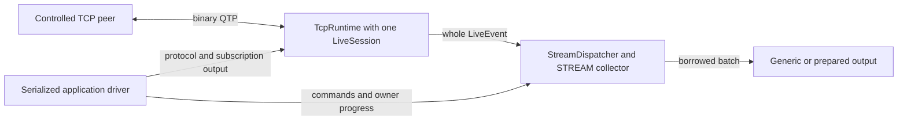

# Controlled STREAM subscriptions

[Русская версия](SUBSCRIPTIONS.ru.md). English is authoritative.

`qdcxx-connect` is an opt-in native STREAM client for a controlled plain-TCP peer.
It composes the existing [TCP runtime](../spec/transport/TCP-RUNTIME.md),
[live session](../spec/subscriptions/LIVE-SESSION.md) and
[local dispatcher](../spec/subscriptions/CLIENT-DISPATCH.md). It selects exact symbols,
prints generic records or an explicitly selected prepared Quote/Profile projection,
and stops at a finite cutoff. This profile does not provide TLS, authentication,
reconnect, wildcard, TICKER/HISTORY or shared upstream multiplexing.



The driver advances both owners in one serialization domain. Command handles and
detached values retain only their documented cross-thread behavior; this diagram
does not create a thread per component.

## Build and entry point

Prepare the exact [qualified SDK sources](../cmake/runtime-profile/README.md).
`ORG_TTLDTOR_QDCXX_BUILD_CONNECT` defaults to `OFF`; enable it together with
`ORG_TTLDTOR_QDCXX_BUILD_CLIENT` and `ORG_TTLDTOR_QDCXX_BUILD_RUNTIME`.
JSON remains optional and is not used by this CLI profile. The executable is
`qdcxx-connect`; its CMake target is `qdcxx_connect`.

No arguments and standalone `--help` print identical English help to stdout and
exit zero without schema/input/network/bootstrap work. Standalone `--help-ru`
prints Russian help with the same zero-work behavior. Invalid, incomplete or mixed
help arguments are usage errors. Failure to write help is an I/O failure.

## Working options

| Option | Meaning and bounds |
| --- | --- |
| `--host IP`, `--port N` | Required numeric endpoint; port 1–65535; no URI, zone or DNS |
| `--symbol SYMBOL` | 1–128 printable ASCII units, no leading `*`; repeat for up to 16 distinct selectors |
| `--schema-profile quote\|profile` | Complete built-in schema; default `quote` |
| `--output generic\|quote\|profile` | Default `generic`; prepared output must match the selected schema |
| `--duration-ms N` | Admission interval 1–600000 ms; default 5000 |
| `--remove-after-ms N` | Optional full-set removal with 0 < N < duration |
| `--max-records N` | Optional completed-record target, 1–1000000; requests an admission cutoff |

The record target is not a hard output cap: the already-admitted eligible prefix
can drain beyond it. With no target, duration remains the finite cutoff. Only
`--symbol` may repeat. Working options consume no stdin commands.

For example, with a controlled peer already listening on the selected port:

```text
qdcxx-connect --host 127.0.0.1 --port 19123 --symbol IBM --schema-profile quote --output generic --duration-ms 5000
```

## Source, schema and selection

Supply a numeric IPv4/IPv6 host and an explicit TCP port for a listening controlled
peer. This CLI performs no hostname resolution. `--schema-profile quote|profile`
selects a complete built-in local schema. Repeat `--symbol` for the exact initial
selection, up to 16 ASCII symbols; this is an explicit CLI restriction. Generic
delivery in the C++ driver also accepts a caller-provided validated `LocalSchema`
and exact UTF-16 symbols. No JSON/schema-file loader is added here.

The local add completes before the driver explicitly composes subscription output
through the actual source owner. Peer readiness, descriptions and source output
remain separate from local command completion. `--remove-after-ms` removes the
entire initial selection through a local remove followed by explicit STREAM_REMOVE
composition. It does not create a dynamic command-input protocol.

Command acceptance, local application, output composition, reported local socket
acceptance and peer acknowledgement are separate observations. The driver does not
report a local write as peer receipt. Retry is limited to the documented readiness
gate and exact output-slot saturation; unrelated resource failures are fatal.

## Generic output

`--output generic` is the default. The diagnostic TSV starts with `qdcxx-stream`
and version `1`. It describes one run/epoch; it is not a binary tape, a serialized
DataScheme or a portable opaque-identity format.

| Row | Cells after the row kind |
| --- | --- |
| `schema` | local ID, record-name UTF16HEX, logical field count |
| `layout` | local ID, logical field index, full type ID, lookup-name UTF16HEX; aliases retain separate rows |
| `record` | ordinal, local ID, sender ID, admission revision, binding generation, cipher, event flags, symbol UTF16HEX, optional removal time, optional field seconds, sequence and source ordinal |
| `field` | record ordinal, logical field index, full type ID, raw scalar, nullable UTF16HEX, nullable BYTEHEX |

Numbers use decimal notation. UTF16HEX uses four uppercase hexadecimal digits per
exact UTF-16 unit; BYTEHEX uses two per byte. Nullable cells use literal `null` for
null and an empty cell for a non-null empty payload. Record ordinals scope field
rows. Values, extra typed fields and raw metadata are preserved within this output
profile. Context validation against the actual caller schema establishes provenance
within the run; pointer addresses and invented cross-run IDs are not emitted.

The schema rows do not reconstruct indexed layouts, the full local-profile policy
or peer descriptions. Use the existing schema/tape contracts for those purposes.
Explicit prepared output uses the existing schema-bound event adapters; it does
not claim that an event projection preserves every generic extra field.

Prepared output starts with `qdcxx-stream-summary`, version `1`, and contains:

| Row | Cells after the row kind |
| --- | --- |
| `quote` | ordinal, symbol UTF16HEX, bid time ms, ask time ms, raw bid price, raw ask price, time ms |
| `profile` | ordinal, symbol UTF16HEX, flags, nullable description UTF16HEX, nullable status-reason UTF16HEX |

These are explicit summaries, not complete event or generic serialization. Use
generic output when additional fields and raw record metadata are required.

## Stop and completion

Duration, optional record cutoff, explicit callback stop and interruption stop new
source admission. The driver advances the local client and TCP owner to their
separate terminal states. An intentional network close may abort an outstanding
operation; it does not certify whole-run drain or successful unsubscribe delivery.
Pending output and Windows unknown write acceptance remain observable.

On Windows, an owned close can report the qualified runtime's native ambiguity:
`READ_FAILURE`, stage `socket-read`, native code `1236`, with `aborted=true`.
The non-cancellation failure is preserved and produces exit 1 even when the local
prefix drained and the cutoff was intentional. It is not reclassified as success.

Peer failure, a partial-frame EOF, callback failure and sink write/flush failure
remain failures. Local terminal does not absorb later sink failure into success.
Application-level signal handling is scoped to the executable and restored on
ordinary return. An arbitrary blocking sink, callback or OS operation has no hard
preemption guarantee.

The driver publishes a `ClientHandle` in a caller-owned initially disengaged
`std::optional` before the first callback. Keep that slot object alive in the owner
domain through the call; use separate synchronized copies across threads. The
application driver retains its own public control reference, so clearing the slot
alone does not request last-handle abort. Use `requestStop` from a callback and
return; do not wait there for terminal. Retained results/batches outlive local
terminal under their existing detached ownership contracts.

The tracked [programmatic example](../examples/subscriptions/example.cpp) exposes
`runSubscriptionExample`: supply a validated ordinary record at local ID zero,
an explicit controlled IPv4 loopback port and a borrowed synchronous output stream.
It selects exact `ALPHA` and prints identity/count coordinates while leaving all
generic fields available to its callback. The [driver declarations](../examples/subscriptions/stream_client.hpp)
document finite options, slot publication and separate terminal evidence.

## Exit status

| Code | Meaning |
| --- | --- |
| `0` | Intentional cutoff or reached data target with the required local/source evidence and no reported failure; not a peer-ACK or whole-network-drain claim |
| `1` | Input/setup/peer/protocol/callback/sink failure, missing terminal evidence or a retained non-cancellation transport error |
| `2` | Interval ended before required add/remove composition or before the requested target was reached |
| `130` | Interruption when no higher-priority failure occurred |

A reported failure takes precedence over interruption or target success. Output
failure also makes help unsuccessful. Diagnostics preserve application facts,
local outcome/counts and transport primary/secondary error stages/native/protocol
codes, abort/peer-end flags and reported/pending/unknown-write evidence.

[Executed validation and limits](../tests/conformance/subscriptions/CONNECT-VALIDATION.md)
separate the controlled profile from full subscription acceptance.
