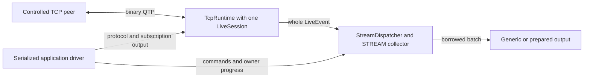

# Контролируемые STREAM-подписки

[English version](SUBSCRIPTIONS.md). Английская версия нормативная.

`qdcxx-connect` — опциональный native STREAM-клиент для контролируемого plain-TCP peer.
Он соединяет существующие [TCP runtime](../spec/transport/TCP-RUNTIME.ru.md),
[live-сессию](../spec/subscriptions/LIVE-SESSION.ru.md) и
[локальный диспетчер](../spec/subscriptions/CLIENT-DISPATCH.ru.md). Клиент выбирает
точные символы, выводит общие записи либо явно выбранное prepared Quote/Profile
представление и останавливается на конечной границе. В этом профиле нет TLS,
аутентификации, reconnect, wildcard, TICKER/HISTORY и общего upstream multiplexing.



Драйвер продвигает обоих владельцев в одной области сериализации. Handles команд
и независимые значения сохраняют только описанные межпоточные гарантии; отдельный
поток на каждый компонент эта схема не создаёт.

## Сборка и точка входа

Подготовьте точные [квалифицированные исходники SDK](../cmake/runtime-profile/README.ru.md).
`ORG_TTLDTOR_QDCXX_BUILD_CONNECT` по умолчанию `OFF`; включите его вместе с
`ORG_TTLDTOR_QDCXX_BUILD_CLIENT` и `ORG_TTLDTOR_QDCXX_BUILD_RUNTIME`.
JSON остаётся необязательным и не используется этим CLI-профилем. Имя executable —
`qdcxx-connect`, CMake target — `qdcxx_connect`.

Без аргументов и с отдельным `--help` выводится одинаковая английская справка в stdout
с кодом ноль, без работы со схемой, входом, сетью или bootstrap. Отдельный `--help-ru`
выводит русскую справку без запуска работы. Некорректные, неполные или смешанные со
справкой аргументы дают usage error. Ошибка записи справки остаётся ошибкой I/O.

## Рабочие параметры

| Параметр | Назначение и границы |
| --- | --- |
| `--host IP`, `--port N` | Обязательный числовой endpoint; port 1–65535; без URI, zone и DNS |
| `--symbol SYMBOL` | 1–128 печатных ASCII units без начального `*`; до 16 разных значений повторением параметра |
| `--schema-profile quote\|profile` | Полная встроенная схема, по умолчанию `quote` |
| `--output generic\|quote\|profile` | По умолчанию `generic`; prepared-вывод должен соответствовать схеме |
| `--duration-ms N` | Интервал приёма 1–600000 мс, по умолчанию 5000 |
| `--remove-after-ms N` | Необязательное удаление всего набора, 0 < N < duration |
| `--max-records N` | Необязательная цель по завершённым записям, 1–1000000; запрашивает отсечку приёма |

Цель по записям не является жёсткой границей вывода: уже принятый допустимый префикс
может доставляться сверх неё. Без цели конечной границей остаётся duration. Повторять
можно только `--symbol`. Команды из stdin не читаются.

Пример для уже слушающего выбранный port контролируемого peer:

```text
qdcxx-connect --host 127.0.0.1 --port 19123 --symbol IBM --schema-profile quote --output generic --duration-ms 5000
```

## Источник, схема и выбор

Задайте числовой IPv4/IPv6 host и явный TCP port слушающего контролируемого peer.
CLI не разрешает имена хостов. `--schema-profile quote|profile` выбирает полную
встроенную локальную схему. Повторяйте `--symbol` для точного начального набора,
до 16 ASCII-символов: это явное ограничение CLI. Общий C++-драйвер также принимает
проверенную вызывающей стороной `LocalSchema` и точные UTF-16 символы. Новый загрузчик
JSON/файла схемы здесь не добавляется.

Локальный add завершается до явной композиции исходящей подписки через настоящего
владельца источника. Готовность peer, описания и исходящие сообщения отделены от
локального завершения команды. `--remove-after-ms` удаляет весь начальный набор:
сначала локальный remove, затем явная композиция STREAM_REMOVE. Динамического
протокола ввода команд этот параметр не создаёт.

Принятие команды, локальное применение, композиция сообщения, отчёт о принятии
локальным сокетом и подтверждение другой стороной — разные наблюдения. Локальная
запись не объявляется получением peer. Повтор ограничен описанной границей готовности
и точным заполнением output-slot; другие ошибки ресурсов завершают работу.

## Общий вывод

`--output generic` выбран по умолчанию. Диагностический TSV начинается с
`qdcxx-stream` и версии `1`. Он описывает один запуск/эпоху; это не бинарный tape,
не сериализованная DataScheme и не переносимый формат непрозрачных идентичностей.

| Строка | Ячейки после вида строки |
| --- | --- |
| `schema` | локальный ID, имя записи UTF16HEX, число логических полей |
| `layout` | локальный ID, индекс логического поля, полный type ID, имя lookup UTF16HEX; aliases сохраняют отдельные строки |
| `record` | ordinal, локальный ID, sender ID, ревизия при приёме, поколение привязки, cipher, event flags, символ UTF16HEX, optional removal time, optional field seconds, sequence и source ordinal |
| `field` | ordinal записи, индекс логического поля, полный type ID, raw scalar, nullable UTF16HEX, nullable BYTEHEX |

Числа записываются десятично. UTF16HEX использует четыре заглавные hex-цифры на точный
UTF-16 unit, BYTEHEX — две на байт. Nullable-ячейка содержит буквальное `null` для null
и пустую ячейку для непустого по nullness, но пустого по длине значения. Ordinal записи
задаёт область строк полей. Значения, дополнительные типизированные поля и исходные
метаданные сохраняются в пределах данного формата. Проверка контекста относительно
настоящей схемы вызывающей стороны устанавливает происхождение внутри запуска;
адреса указателей и выдуманные межзапусковые ID не выводятся.

Строки схемы не восстанавливают indexed layout, полную политику локального профиля
или описания peer. Для этого применяются отдельные контракты схемы/tape.
Явное prepared-представление использует существующие привязанные к схеме адаптеры
событий и не заявляет сохранения каждого дополнительного общего поля.

Prepared-вывод начинается с `qdcxx-stream-summary`, версии `1`, и содержит:

| Строка | Ячейки после вида строки |
| --- | --- |
| `quote` | ordinal, символ UTF16HEX, bid time ms, ask time ms, raw bid price, raw ask price, time ms |
| `profile` | ordinal, символ UTF16HEX, flags, nullable description UTF16HEX, nullable status-reason UTF16HEX |

Это явные краткие представления, не полная сериализация события или общей записи.
Для дополнительных полей и исходных метаданных записи используйте generic-вывод.

## Остановка и завершение

Длительность, необязательная граница записей, явная остановка из callback и прерывание
закрывают приём новых событий источника. Драйвер продвигает локальный клиент и TCP
до их отдельных terminal. Намеренное закрытие сети может отменить незавершённую
операцию; оно не подтверждает полное опустошение запуска или успешную доставку
отписки. Незавершённый вывод и неизвестное принятие записи Windows остаются наблюдаемыми.

При собственном закрытии Windows возможен описанный в квалификации runtime
неоднозначный native-исход: `READ_FAILURE`, stage `socket-read`, код `1236`,
`aborted=true`. Ошибка, не являющаяся отменой, сохраняется и даёт exit 1, даже
если локальный префикс доставлен и отсечка была намеренной. Она не объявляется успехом.

Сбой peer, EOF частичного кадра, ошибка callback и ошибка записи/flush приёмника
остаются ошибками. Локальный terminal не превращает последующую ошибку приёмника
в успех. Прикладная обработка сигналов ограничена executable и восстанавливается
при обычном возврате. Для произвольно блокирующего приёмника, callback или операции
ОС нет гарантии жёсткого принудительного прерывания.

До первого callback драйвер публикует `ClientHandle` в принадлежащем вызывающей
стороне изначально незаполненном `std::optional`. Сохраняйте сам объект слота в области
владельца до возврата; между потоками используйте отдельные синхронизированно переданные
копии. Прикладной драйвер удерживает собственную публичную управляющую ссылку, поэтому
очистка слота сама по себе не запрашивает last-handle abort. Из callback вызывайте
`requestStop` и возвращайтесь; не ждите там terminal. Удержанные результаты/батчи
переживают локальный terminal по существующим контрактам независимого владения.

Отслеживаемый [программный пример](../examples/subscriptions/example.cpp) предоставляет
`runSubscriptionExample`: передайте проверенную обычную запись с локальным ID ноль,
явный port контролируемого IPv4 loopback peer и заимствованный синхронный поток вывода.
Он выбирает точный `ALPHA`, выводит координаты идентичности/количества и оставляет все
общие поля доступными callback. [Объявления драйвера](../examples/subscriptions/stream_client.hpp)
описывают конечные параметры, публикацию слота и раздельные terminal-факты.

## Коды завершения

| Код | Назначение |
| --- | --- |
| `0` | Намеренная отсечка либо достигнутая цель по данным с нужными локальными/транспортными фактами без сообщённой ошибки; не подтверждение peer ACK или полного опустошения сети |
| `1` | Ошибка входа/setup/peer/протокола/callback/приёмника, отсутствие terminal-фактов или сохранённая транспортная ошибка, не являющаяся отменой |
| `2` | Интервал закончился до нужной композиции add/remove либо до достижения заданной цели |
| `130` | Прерывание без ошибки с более высоким приоритетом |

Сообщённая ошибка важнее прерывания или достигнутой цели. Ошибка вывода делает
неуспешной и справку. Диагностика сохраняет прикладные факты, локальный исход/счётчики,
primary/secondary transport stages/native/protocol codes, признаки abort/peer-end,
сведения о сообщённых/ожидающих/неизвестно принятых записях.

[Выполненные проверки и ограничения](../tests/conformance/subscriptions/CONNECT-VALIDATION.ru.md)
отделяют контролируемый профиль от приёмки полных подписок.
