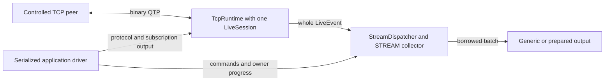

# Получение данных по подпискам

[English version](SUBSCRIPTIONS.md). Английская версия нормативная.

Начните с готового консольного приёмника ниже либо используйте `qdcxx-connect --mode recovery`
для STREAM, TICKER или индексированной HISTORY. Продвижением и конечными ресурсами управляет
вызывающее приложение. CLI выбирает одно семейство, одну запись и одного логического клиента
на запуск. Несколько логических подписок приложение может собрать через
[публичный API приёмника](SUBSCRIPTION-RECEIVER.ru.md).
Вызовы без `--mode recovery` сохраняют [прежний STREAM-профиль](#subscription-legacy-stream-ru).

## Сборка консольного приёмника

Соберите и установите библиотеку с `ORG_TTLDTOR_QDCXX_BUILD_CLIENT=ON`,
`ORG_TTLDTOR_QDCXX_BUILD_RUNTIME=ON` и `ORG_TTLDTOR_QDCXX_BUILD_RECOVERY=ON`.
Используйте поддерживаемый компилятор и точные подготовленные Asio/c-ares из
[руководства по сборке](CPP-BUILD.ru.md). Получение SDK выполняется явно и не является частью
приёма данных. Подходит существующая квалифицированная установка или подготовленный локальный кеш.

Полное [C++ приложение Quote](../examples/subscriptions/receiver/quote.cpp) — отдельный потребитель
установленной библиотеки с публичным callback `SubscriptionConsumer`, prepared Quote mapping
и собственным циклом продвижения. Из checkout соберите его против своей установки:

```powershell
cmake -S examples/subscriptions/receiver -B build/quote-subscriber '-Dqdcxx_DIR=C:/dev/qdcxx/install/lib/cmake/qdcxx'
cmake --build build/quote-subscriber --config Release
```

После сборки Visual Studio запустите из корня checkout:

```powershell
./build/quote-subscriber/Release/qdcxx-quote-subscription.exe --help
```

Одноконфигурационные Windows-генераторы используют `./build/quote-subscriber/qdcxx-quote-subscription.exe`;
Linux обычно использует `./build/quote-subscriber/qdcxx-quote-subscription`. Из каталога executable
PowerShell требует `./qdcxx-quote-subscription.exe`. Если установленный пакет собран с TLS,
при конфигурации потребителя также нужен точный `ORG_TTLDTOR_QDCXX_OPENSSL_ROOT`, даже для этого
обычного TCP-приёмника. [Руководство примеров](../examples/subscriptions/README.ru.md) объясняет callback и владение.

Если совместимый binary QTP-источник уже слушает указанный адрес:

```powershell
./build/quote-subscriber/Release/qdcxx-quote-subscription.exe --host 127.0.0.1 --port 19123 --symbol IBM --duration-ms 5000
```

Встроенного сервиса на этом порту нет. Подставьте адрес/порт своего источника и поддерживаемый им
символ; источник должен объявить совместимое описание Quote. Программа печатает фактические raw bits
bid/ask. У `WideDecimal` raw zero означает NaN; для представления цен используйте `toString()` либо
`toDouble()`. Пример работает по обычному TCP; проверяемый TLS отдельно доступен в CLI ниже.

## CLI с восстановлением соединения

Дополнительно включите `ORG_TTLDTOR_QDCXX_BUILD_CONNECT=ON` и соберите target `qdcxx_connect`,
создающий `qdcxx-connect`. Для внешних native binary JSON-схем нужен
`ORG_TTLDTOR_QDCXX_BUILD_SCHEMA_JSON=ON`, для TLS — `ORG_TTLDTOR_QDCXX_BUILD_TLS=ON` и
[точный квалифицированный статический SDK](CPP-BUILD.ru.md#tls-source-profile-cpp-build-ru). Недоступная возможность
отвергается до чтения файлов и активации. Вызов без аргументов и отдельные `--help`/`--help-ru`
не требуют endpoint, файлов схемы или сети. Полные параметры находятся в
[справочнике инструмента](../tools/subscribe/README.ru.md).
Короткие имена в командах ниже предполагают каталог executable в `PATH`; иначе замените имя
полным путём либо используйте `./name.exe` из его каталога в PowerShell.

Команды требуют существующего совместимого источника. STREAM доставляет выбранные записи;
TICKER предоставляет контракт последних значений и может объединять промежуточные обновления.
Явно выбранный prepared output добавляет Quote/Profile-строки, сохраняя все generic-поля:

```text
qdcxx-connect --mode recovery --host 127.0.0.1 --port 19123 --symbol IBM --family stream --schema-profile quote --output quote --duration-ms 5000
qdcxx-connect --mode recovery --host 127.0.0.1 --port 19123 --symbol IBM --family ticker --schema-profile profile --output profile --duration-ms 5000
```

Обе встроенные схемы полные и обычные. Для собственной схемы явно укажите локальный ID записи.
HISTORY требует индексные метаданные и знаковую int64 raw lower bound:

```text
qdcxx-connect --mode recovery --host 127.0.0.1 --port 19123 --symbol IBM --family history --schema-json spec/schema/examples/native-binary/pair.json --record-id 0 --history-from-raw 0 --output generic --duration-ms 5000
```

Команда с относительным путём схемы запускается из корня checkout; можно указать абсолютный путь.
Отслеживаемая [pair-index схема](../spec/schema/examples/native-binary/pair.json) описывает
`TimeAndSale` с Time/Sequence contributors; источник должен поддерживать эту запись/схему.
`--history-from-raw` — точная знаковая индексная идентичность, **не Unix milliseconds и не бизнес-время
события**. Выбирайте границу по [контракту индексных схем](../spec/schema/INDEXED-SCHEMAS.ru.md) и
[формату native binary JSON](../spec/schema/NATIVE-BINARY-JSON.ru.md). Файл описывает данные;
он не создаёт источник и не добавляет peer поддержку неизвестной записи.

Числовой host обходит DNS. Для имени обязателен явный числовой IPv4 `--dns-server`, при необходимости
с `--dns-port`; системный resolver не обнаруживается. DNS использует дополнительные 80 MiB логического
резерва запрошенной памяти и отдельный консервативный профиль работы. Это не предел RSS.

## Проверяемый TLS и необязательный Basic token

Если сертификат TLS-источника действителен для `feed.example`, задайте свой trust-файл и reference
identity. Адрес маршрута и проверяемая идентичность независимы:

```text
qdcxx-connect --mode recovery --host 127.0.0.1 --port 19443 --symbol IBM --family stream --schema-profile quote --security tls --tls-trust-pem C:/dev/qd/trust.pem --tls-reference feed.example --duration-ms 5000
```

Адрес/порт и файлы здесь заменяются значениями вашего источника. Trust содержит обычные
`CERTIFICATE` PEM blocks: максимум 524288 байтов/256 блоков. Нет system-trust fallback или перехода
на plaintext. Executable использует узкий [замкнутый TLS-профиль](../spec/cli/TLS-HOST-PROFILE.ru.md):
новый процесс, один точный статический SDK image и последовательный владелец, без других
пользователей SDK/хуков или общей мутации, с отсутствующей `OPENSSL_ia32cap`. Фиксированный preflight
выполняется до декодирования сертификатов. Это обязанности данного TLS-маршрута, а не автоматическое
обнаружение всех пользователей SDK в произвольном процессе.

Если проверенный источник требует Basic authentication, добавьте:

```text
qdcxx-connect --mode recovery --host 127.0.0.1 --port 19443 --symbol IBM --family stream --schema-profile quote --security tls --tls-trust-pem C:/dev/qd/trust.pem --tls-reference feed.example --auth-basic-token-file C:/dev/qd/basic-token.txt --auth-timeout-ms 1000 --duration-ms 5000
```

Файл содержит полный префикс `Basic ` и канонический base64 token как точные ASCII bytes,
максимум 4096 байтов, **без newline, trimming или нормализации**. Не помещайте credentials в argv.
Файлы читаются один раз после проверки возможностей/аргументов; диагностика не повторяет пути,
identity или token. Credentials запрашивает проверенный TLS-адаптер. Поддерживаемые криптографические
и peer-ограничения описаны в [TLS-контракте](../spec/transport/TLS-RUNTIME.ru.md).

## Наблюдение восстановления и завершение

Добавьте `--attempts 3 --retry-delay-ms 250` для максимум трёх новых попыток, включая первую.
После подходящих ошибок воспроизводится текущий desired set. `--remove-after-ms 1000` один раз
удаляет начальные ключи; момент должен предшествовать концу admission interval. Нет stdin command
language, wildcard или обещания exactly-once replay. Превышение фиксированных входных лимитов/cache
видимо отвергается; лимиты не растут неявно. Ошибка setup/factory может завершить запуск раньше всех попыток.

Stdout содержит `qdcxx-subscriptions` TSV version 1; stderr — фактические команды, phase, reset,
HISTORY и terminal observations. Reset публикуется перед его точным acknowledgement; смены epoch
и разрывы видимы. Перед разбором строк прочтите [контракт вывода](../spec/cli/RECOVERY-OUTPUT.ru.md).
HISTORY-наблюдения дают локальное AS-OF evidence; недопустимый range query означает unknown,
а не ранее сохранённую полноту. Flags, `ACTIVE`, local drain и сами записи не доказывают завершение snapshot.

Duration или достигнутый record target запрашивает local drain с `--drain-ms` (по умолчанию 1000).
Целый допущенный callback batch может пересечь `--max-records`; его суффикс сохраняется. Drain охватывает
только ранее допущенный локальный префикс и может истечь с ошибкой; он не доказывает peer ACK или
whole-network flush. SIGINT/SIGTERM запрашивает abort; progress/drain используют тот же конечный work
profile. Для блокирующего output stream или native operation нет hard preemption guarantee.

Коды recovery: `0` — фактический DRAINED без expiry и выполненные readiness/commands/targets;
`1` — setup/protocol/transport/output/retirement failure; `2` — usage либо недостигнутые readiness/target;
`130` — обработанный сигнал после фактического ABORTED. Ошибка важнее interruption.
Допустимость наблюдений, reset/replay и shutdown определяет [recovery-контракт](../spec/transport/RECOVERY.ru.md).

<a id="контролируемые-stream-подписки"></a>
<a id="subscription-legacy-stream-ru"></a>

## Прежний контролируемый STREAM-драйвер

Все разделы ниже относятся к вызовам **без `--mode recovery`** и существующему примеру `runStream`.
Их формат вывода, endpoint snapshot overload и правила terminal сохранены.

Для приложений с общими очередями и prepared-callback начните с
[получения generic-записей и подготовленных событий](SUBSCRIPTION-RECEIVER.ru.md).
Ниже описаны контролируемый CLI и явные настройки его драйвера.

`qdcxx-connect` — опциональный native STREAM-клиент для контролируемого plain-TCP peer.
Он соединяет существующие [TCP runtime](../spec/transport/TCP-RUNTIME.ru.md),
[live-сессию](../spec/subscriptions/LIVE-SESSION.ru.md) и
[локальный диспетчер](../spec/subscriptions/CLIENT-DISPATCH.ru.md). Клиент выбирает
точные символы, выводит общие записи либо явно выбранное prepared Quote/Profile
представление и останавливается на конечной границе. В этом профиле нет TLS,
аутентификации, reconnect, wildcard, TICKER/HISTORY и общего upstream multiplexing.



Драйвер продвигает обоих владельцев в одной области сериализации. Handles команд
и независимые значения сохраняют только описанные межпоточные гарантии; отдельный
поток на каждый компонент эта схема не создаёт.

## Сборка и точка входа

Подготовьте точные [квалифицированные исходники SDK](../cmake/runtime-profile/README.ru.md).
`ORG_TTLDTOR_QDCXX_BUILD_CONNECT` по умолчанию `OFF`; включите его вместе с
`ORG_TTLDTOR_QDCXX_BUILD_CLIENT` и `ORG_TTLDTOR_QDCXX_BUILD_RUNTIME`.
JSON остаётся необязательным и не используется этим CLI-профилем. Имя executable —
`qdcxx-connect`, CMake target — `qdcxx_connect`.

Без аргументов и с отдельным `--help` выводится одинаковая английская справка в stdout
с кодом ноль, без работы со схемой, входом, сетью или bootstrap. Отдельный `--help-ru`
выводит русскую справку без запуска работы. Некорректные, неполные или смешанные со
справкой аргументы дают usage error. Ошибка записи справки остаётся ошибкой I/O.

## Рабочие параметры

| Параметр | Назначение и границы |
| --- | --- |
| `--host IP`, `--port N` | Обязательный числовой endpoint; port 1–65535; без URI, zone и DNS |
| `--symbol SYMBOL` | 1–128 печатных ASCII units без начального `*`; до 16 разных значений повторением параметра |
| `--schema-profile quote\|profile` | Полная встроенная схема, по умолчанию `quote` |
| `--output generic\|quote\|profile` | По умолчанию `generic`; prepared-вывод должен соответствовать схеме |
| `--duration-ms N` | Интервал приёма 1–600000 мс, по умолчанию 5000 |
| `--remove-after-ms N` | Необязательное удаление всего набора, 0 < N < duration |
| `--max-records N` | Необязательная цель по завершённым записям, 1–1000000; запрашивает отсечку приёма |
| `--connect-timeout-ms N` | Deadline соединения, 1..2147483647 мс; по умолчанию 1000 |
| `--read-timeout-ms N` | Deadline неактивности ввода, 1..2147483647 мс; по умолчанию duration |
| `--write-timeout-ms N` | Deadline неактивности вывода, 1..2147483647 мс; по умолчанию duration |
| `--poll-interval-ms N` | Период прогресса вызывающего кода, 1..2147483647 мс; по умолчанию 1 |
| `--security plain\|tls` | По умолчанию `plain`; `tls` отклоняется до схемы/signals/bootstrap/сети |

Цель по записям не является жёсткой границей вывода: уже принятый допустимый префикс
может доставляться сверх неё. Без цели конечной границей остаётся duration. Повторять
можно только `--symbol`. Команды из stdin не читаются.

Пример для уже слушающего выбранный port контролируемого peer:

```text
qdcxx-connect --host 127.0.0.1 --port 19123 --symbol IBM --schema-profile quote --output generic --duration-ms 5000
```

<a id="endpoint-options"></a>

## Явные параметры конечной точки

Подключите [`qd/client/endpoint_options.hpp`](../include/qd/client/endpoint_options.hpp)
и свяжите `qdcxx_client`. `EndpointOptions::create(schema, settings)` копирует проверенную
`LocalSchema` и явные `EndpointSettings` в неизменяемый владеющий снимок, сохраняя
происхождение схемы. Входы читаются один раз; environment, JSON, файлы, Java properties
и глобальные defaults не разрешаются. Общие записи сохраняют схему вызывающего кода;
CLI по-прежнему выбирает полную встроенную Quote/Profile-схему.
[Справка по конфигурации](CONFIGURATION.ru.md) описывает типизированные поля и единицы.

`controlledStreamSettings(duration)` задаёт прежние бюджеты контролируемого примера C++.
Duration по умолчанию 5000 мс, допустимо 1..600000 мс; DNS/connect по умолчанию 1000 мс,
read/write равны duration, poll — 1 мс. Host пустой, port нулевой, пока их не задаст
вызывающий код. Это явные значения примера, а не Java/defaults процесса. Каждый timeout
положителен и не превышает `INT_MAX` миллисекунд. Ёмкости компонентов и работа хода
сохраняют отдельные оси байтов/количества/UTF-16 units; квота на весь поток не вводится.

Прежний overload `runStream(bootstrap, schema, options, consumer, publishedHandle)`
и поля/defaults `StreamOptions` сохраняют поведение. У нового overload второй аргумент —
`const client::EndpointOptions &endpoint`. Пустой legacy `options.host` и нулевой
`options.port` независимо означают отсутствие значения; каждое заданное значение должно
совпадать со снимком. Конфликт отклоняется до использования bootstrap или I/O этим driver.
У вызывающего кода уже может быть bootstrap или другие работающие endpoint.
Выбор записи/символов и конечные условия приёма остаются в `StreamOptions`.

Эффективные dispatch operations равны
`min(endpoint.settings().budgets.dispatchTurn.operations, options.ownerOperationsPerTurn)`;
прежний cap допускает 1..10000. Остальные оси сохраняют заданные значения для обычных
и применимых shutdown/drain ходов, без подмены более щедрыми defaults helper.
Новый контролируемый driver требует достаточного профиля неделимых операций:

- Dispatch: `operations >= 1`, `commands >= 1`, `records >= max(1,
  client.commandEntries, collector.frames + collector.records + фактическое число
  записей схемы + desired.entries)` и
  `bytes >= max(collector.residentBytes, session.residentBytes)`.
- Вложенная работа collector: `operations >= 1`, `visits >= collector.records + collector.frames`,
  `bytes >= collector.frames * session.residentBytes`.
- Runtime work: `steps >= 1`, `handlers >= 1`,
  `socketBytes >= max(tcp.inputBytes, tcp.writeBytes)`.
- Для выбранного `recordId` кредиты полей dispatch не меньше удвоенного числа полей
  локальной записи. Суммы/произведения проверяются до использования.

Это ограничения выбранного driver. Общие параметры и прежний `TcpRuntime` могут
представлять допустимые меньшие профили частичного продвижения/передачи настроек.
Граница полного кванта записи консервативна и не является универсальным минимумом TCP.
`requirePlainStream()` проверяет выбранный профиль; `runStream` — границу записи.
Только фактический `ClientError::WORK_LIMIT` из первого progress диспетчера на свежем
локальном ходе, до любого успешного шага, даёт видимый отказ `DISPATCH` со статической
диагностикой `endpoint-dispatch-work` и запрос abort с теми же кредитами. Успешный шаг
с последующим `YIELD` на остатке хода, native `YIELD`/`IDLE` и обычное ожидание сохраняют
смысл. Прежний overload сохраняет старую политику.

`EndpointSecurity::TLS` запрашивает транспортную политику и не подтверждает проверку.
TLS identity/PEM проверяются локально по форме/размеру. Проверка доверия, SAN/identity,
handshake и вызов credentials относятся к адаптеру проверенного TLS. Конфигурация
никогда не вызывает необязательный Basic provider. Границы TLS handshake/close явные;
authentication timeout/token capacity обязательны только с provider. Текущий driver
отклоняет TLS, DNS-host и retry больше одной попытки до собственного I/O; хранение
handoff-значений не включает TLS/authentication/DNS/reconnect.

Разные handles снимка можно копировать/читать/освобождать в разных потоках; замену
или уничтожение одного и того же handle нужно синхронизировать. Удерживайте снимок
при использовании заимствованных `settings()`/`schema()`. Перемещённому handle допустимы
только присваивание/уничтожение. Shared state/captures/resources provider и работа
callback/деструктора остаются у вызывающего кода вне бюджетов конфигурации. Последний
shared release может уничтожить provider в своём потоке. Для произвольного пользовательского
кода/native cleanup нет жёсткой границы времени.

Полный [пример endpoint options](../tests/conformance/endpoint_options_consumer/main.cpp)
содержит заголовки и `main`, создаёт два независимых снимка и не запускает runtime/сеть.
Его [CMake project](../tests/conformance/endpoint_options_consumer/CMakeLists.txt) связывает
`qdcxx_client qdcxx_quote` с установленным runtime/JSON-OFF пакетом;
см. [инструкции сборки](CPP-BUILD.ru.md#endpoint-options-build). При успехе stdout:

```text
Independent endpoint snapshots: 7301, 7302
```

При успешной конфигурации/выводе код завершения равен нулю. См.
[выполненную валидацию параметров](../tests/conformance/subscriptions/OPTIONS-VALIDATION.ru.md).

## Источник, схема и выбор

Задайте числовой IPv4/IPv6 host и явный TCP port слушающего контролируемого peer.
CLI не разрешает имена хостов. `--schema-profile quote|profile` выбирает полную
встроенную локальную схему. Повторяйте `--symbol` для точного начального набора,
до 16 ASCII-символов: это явное ограничение CLI. Общий C++-драйвер также принимает
проверенную вызывающей стороной `LocalSchema` и точные UTF-16 символы. Новый загрузчик
JSON/файла схемы здесь не добавляется.

Локальный add завершается до явной композиции исходящей подписки через настоящего
владельца источника. Готовность peer, описания и исходящие сообщения отделены от
локального завершения команды. `--remove-after-ms` удаляет весь начальный набор:
сначала локальный remove, затем явная композиция STREAM_REMOVE. Динамического
протокола ввода команд этот параметр не создаёт.

Принятие команды, локальное применение, композиция сообщения, отчёт о принятии
локальным сокетом и подтверждение другой стороной — разные наблюдения. Локальная
запись не объявляется получением peer. Повтор ограничен описанной границей готовности
и точным заполнением output-slot; другие ошибки ресурсов завершают работу.

## Общий вывод

`--output generic` выбран по умолчанию. Диагностический TSV начинается с
`qdcxx-stream` и версии `1`. Он описывает один запуск/эпоху; это не бинарный tape,
не сериализованная DataScheme и не переносимый формат непрозрачных идентичностей.

| Строка | Ячейки после вида строки |
| --- | --- |
| `schema` | локальный ID, имя записи UTF16HEX, число логических полей |
| `layout` | локальный ID, индекс логического поля, полный type ID, имя lookup UTF16HEX; aliases сохраняют отдельные строки |
| `record` | ordinal, локальный ID, sender ID, ревизия при приёме, поколение привязки, cipher, event flags, символ UTF16HEX, optional removal time, optional field seconds, sequence и source ordinal |
| `field` | ordinal записи, индекс логического поля, полный type ID, raw scalar, nullable UTF16HEX, nullable BYTEHEX |

Числа записываются десятично. UTF16HEX использует четыре заглавные hex-цифры на точный
UTF-16 unit, BYTEHEX — две на байт. Nullable-ячейка содержит буквальное `null` для null
и пустую ячейку для непустого по nullness, но пустого по длине значения. Ordinal записи
задаёт область строк полей. Значения, дополнительные типизированные поля и исходные
метаданные сохраняются в пределах данного формата. Проверка контекста относительно
настоящей схемы вызывающей стороны устанавливает происхождение внутри запуска;
адреса указателей и выдуманные межзапусковые ID не выводятся.

Строки схемы не восстанавливают indexed layout, полную политику локального профиля
или описания peer. Для этого применяются отдельные контракты схемы/tape.
Явное prepared-представление использует существующие привязанные к схеме адаптеры
событий и не заявляет сохранения каждого дополнительного общего поля.

Prepared-вывод начинается с `qdcxx-stream-summary`, версии `1`, и содержит:

| Строка | Ячейки после вида строки |
| --- | --- |
| `quote` | ordinal, символ UTF16HEX, bid time ms, ask time ms, raw bid price, raw ask price, time ms |
| `profile` | ordinal, символ UTF16HEX, flags, nullable description UTF16HEX, nullable status-reason UTF16HEX |

Это явные краткие представления, не полная сериализация события или общей записи.
Для дополнительных полей и исходных метаданных записи используйте generic-вывод.

## Остановка и завершение

Длительность, необязательная граница записей, явная остановка из callback и прерывание
закрывают приём новых событий источника. Драйвер продвигает локальный клиент и TCP
до их отдельных terminal. Намеренное закрытие сети может отменить незавершённую
операцию; оно не подтверждает полное опустошение запуска или успешную доставку
отписки. Незавершённый вывод и неизвестное принятие записи Windows остаются наблюдаемыми.

При собственном закрытии Windows возможен описанный в квалификации runtime
неоднозначный native-исход: `READ_FAILURE`, stage `socket-read`, код `1236`,
`aborted=true`. Ошибка, не являющаяся отменой, сохраняется и даёт exit 1, даже
если локальный префикс доставлен и отсечка была намеренной. Она не объявляется успехом.

Сбой peer, EOF частичного кадра, ошибка callback и ошибка записи/flush приёмника
остаются ошибками. Локальный terminal не превращает последующую ошибку приёмника
в успех. Прикладная обработка сигналов ограничена executable и восстанавливается
при обычном возврате. Для произвольно блокирующего приёмника, callback или операции
ОС нет гарантии жёсткого принудительного прерывания.

До первого callback драйвер публикует `ClientHandle` в принадлежащем вызывающей
стороне изначально незаполненном `std::optional`. Сохраняйте сам объект слота в области
владельца до возврата; между потоками используйте отдельные синхронизированно переданные
копии. Прикладной драйвер удерживает собственную публичную управляющую ссылку, поэтому
очистка слота сама по себе не запрашивает last-handle abort. Из callback вызывайте
`requestStop` и возвращайтесь; не ждите там terminal. Удержанные результаты/батчи
переживают локальный terminal по существующим контрактам независимого владения.

Отслеживаемый [программный пример](../examples/subscriptions/example.cpp) предоставляет
`runSubscriptionExample`: передайте проверенную обычную запись с локальным ID ноль,
явный port контролируемого IPv4 loopback peer и заимствованный синхронный поток вывода.
Он выбирает точный `ALPHA`, выводит координаты идентичности/количества и оставляет все
общие поля доступными callback. [Объявления драйвера](../examples/subscriptions/stream_client.hpp)
описывают конечные параметры, публикацию слота и раздельные terminal-факты.

## Коды завершения

| Код | Назначение |
| --- | --- |
| `0` | Намеренная отсечка либо достигнутая цель по данным с нужными локальными/транспортными фактами без сообщённой ошибки; не подтверждение peer ACK или полного опустошения сети |
| `1` | Ошибка входа/setup/peer/протокола/callback/приёмника, отсутствие terminal-фактов или сохранённая транспортная ошибка, не являющаяся отменой |
| `2` | Интервал закончился до нужной композиции add/remove либо до достижения заданной цели |
| `130` | Прерывание без ошибки с более высоким приоритетом |

Сообщённая ошибка важнее прерывания или достигнутой цели. Ошибка вывода делает
неуспешной и справку. Диагностика сохраняет прикладные факты, локальный исход/счётчики,
primary/secondary transport stages/native/protocol codes, признаки abort/peer-end,
сведения о сообщённых/ожидающих/неизвестно принятых записях.

[Выполненные проверки и ограничения](../tests/conformance/subscriptions/CONNECT-VALIDATION.ru.md)
отделяют контролируемый профиль от приёмки полных подписок.
