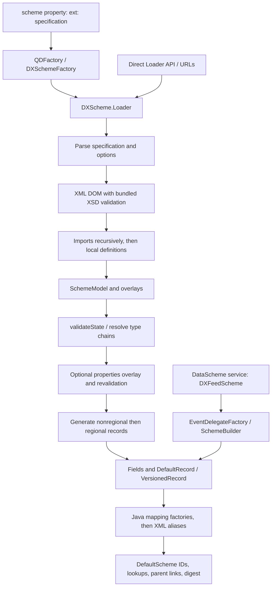

# XML scheme and DataScheme semantic inventory

Initial descriptive analysis for QDCXX-003, against Java QD **3.355**, commit **`0ddc0a09779fb61d74cc0b37c6449ff47dcb715f`**. This is not a normalized format or a C++ design. Upstream citations resolve through the [source inventory](SOURCES.md) to that immutable commit.

Evidence labels:

- **S — Observed/source:** directly inspected implementation; not a claim that a Java experiment was run.
- **D — Documented:** Javadoc, XSD declarations/annotations, or test assertions. Citing a test does not mean it passed in this investigation.
- **I — Inferred:** explicitly identified consequence or proposed direction, not an upstream contract.
- **U — Unresolved:** an unmeasured edge case, environment dependence, or compatibility decision requiring follow-up.
- **R — Runtime capture:** executed against the locked Java source under the bounded QDCXX-005 profile; not automatically a normative C++ requirement.

QDCXX-003 verified the checkout and inspected source without executing Java. QDCXX-005 subsequently built the locked Java source and captured 17 bounded subcases; see [measured evidence](#measured-evidence-qdcxx-005), [coverage](../../tests/fixtures/schema/COVERAGE.md) and [validation](../../tests/fixtures/schema/VALIDATION.md). No upstream test-suite run or copied upstream source/XML is claimed. Remaining [open questions](../../docs/upstream/OPEN-QUESTIONS.md#schema-investigation-qdcxx-003) stay explicit.

## Effective path and resolution order

1. **S:** `QDFactory.createDefaultScheme(ClassLoader)` reads `scheme`, tries `DataSchemeFactory` services when non-null, and returns the first non-null result. `DXSchemeFactory.createDataScheme` accepts `ext:`, removes it, and invokes the loader. Without an accepted result, `QDFactory` uses a `DataScheme` service. XML is an available construction path, not the definition of every `DataScheme`. [Entry points](SOURCES.md#entry-points)
2. **S/D:** `SchemeModelLoader.parseSpecification` splits on commas; relative URLs resolve against the working directory. `resource:` must resolve to exactly one classloader resource. `dxfeed` expands to `resource:dxfeed.xml` **and enables** `dxprops`/`sysprops`. `opt:` changes options in encounter order (`no-` disables); files subsequently use the resulting options. Loader input methods append URLs. An empty URL list fails. [Loading](SOURCES.md#loading)
3. **S:** Only `xml` is registered as a top-level format, selected by URL file extension. `loadFileAndImports` marks a URL seen before reading; repeated URLs, including import cycles returning to a seen URL, are skipped. Imports resolve relative to the importing URL and reuse its reader. This is URL-set deduplication, not a content-hash or filesystem-canonicalization guarantee. [Loading](SOURCES.md#loading)
4. **S:** `XmlSchemeModelReader.readModel` parses/validates the whole document first, processes imports in order, then local types, enums, records/generators, mappings and visibility. Imported entities enter the same model. Top-level URLs are processed in specification order; entities retain file provenance. [XML](SOURCES.md#xml)
5. **S:** After all files, `SchemeModel.validateState` validates types, enums, records and generators. It collects `SchemeException`s per top-level entity. Parsing/merge errors can stop earlier; this is not aggregation of every possible failure. [Model](SOURCES.md#model)
6. **S:** `DXScheme.configureSchemeModel` optionally applies a properties-derived overlay after XML and revalidates. System properties are copied first; enabled explicit loader properties replace equal keys. `DXFeedPropertiesConverter.convertProperties` can log an error and return null after catching `Throwable`; not every property failure is fatal. [Properties](SOURCES.md#properties)
7. **S:** `DXScheme.loadRecords` expands the model, constructs records, adds XML aliases, and passes the array plus `PentaCodec.INSTANCE` to `DefaultScheme`. Its constructor verifies IDs/names and attaches records to the scheme. [Runtime](SOURCES.md#runtime)

## XML syntax and defaults

**D/S:** Active grammar: bundled `dxfeed-schema.xsd`, namespace `https://www.dxfeed.com/datascheme`, root `dxfeed`. `XmlSchemeModelFormat` configures namespace-aware validating DOM parsing with that resource. The separately shipped `dxfeed-schema-1.1.xsd` is not selected by this loader. The active XSD orders top-level collections as imports, types, enums, records, mappings, visibility. Grammar validation is distinct from post-merge validation. [XML](SOURCES.md#xml)

| Surface | Evidence and behavior |
| --- | --- |
| Names | **D:** `schemeName` declares `[a-zA-Z_][a-zA-Z0-9_]*`; `schemeExtendedName` for aliases permits an initial digit and dots. **S:** generator output names concatenate iterator strings/delimiters beyond source record-name syntax. [XML](SOURCES.md#xml), [Generator](SOURCES.md#generator) |
| XML defaults | **D:** entity `mode=new`; alias/tag `mode=add`; record `disabled=false`, `regionals=false`; field `disabled=false`, `compositeOnly=false`; alias `main=false`; generator `type=suffix`, `delimiter=""`; a present iterator has `mode=new`; visibility `field=""`, `useEventName=false`. **S:** reader consumes DOM attributes, so XML defaults participate in updates. [XML](SOURCES.md#xml) |
| Documentation | **D:** XSD `docString` uses whitespace replacement. **S:** reader uses `getTextContent`; `NamedEntity.override` replaces docs only when supplied. Exact DOM text normalization remains a capture case. [XML](SOURCES.md#xml), [Model](SOURCES.md#model) |
| Metadata | **S:** model retains imports, types, enums, records/templates, generators, visibility, docs, aliases, tags, bitfields and file origins. Runtime consumes only a subset. `loadMappings` is explicitly empty. [Model](SOURCES.md#model), [XML](SOURCES.md#xml) |
| Data value defaults | **S:** record-field grammar has no generic initial-value attribute; `buildOneRecord` constructs descriptors, not cursor data. Mapping syntax's `value` is not an implemented runtime default. Compiled event getters separately supply defaults for absent optional fields, e.g. `QuoteMapping.getSequence` returns zero. [XML](SOURCES.md#xml), [Mappings](SOURCES.md#mappings) |

**S/U:** Boolean attributes use Java Boolean parsing. Child helpers compare `getNodeName()` to unprefixed names despite namespace checks. Numeric boolean forms and prefix-qualified elements need isolated captures. XSD permits repeated visibility tag-list containers while `processChildCollection` finds only the first. These source discrepancies must not be silently normalized away. [XML](SOURCES.md#xml)

## Types, enums and validation

- **S/D:** Custom types alias embedded or custom types. `SchemeType.validateState` resolves chains after merging and rejects unknown bases, self-reference and cycles. `SchemeModel.addType` rejects embedded-name collisions. Forward type references resolve at final validation; record copying differs. [Types](SOURCES.md#types)
- **S:** `DefaultEmbeddedTypes` reflects public static final `SerialFieldType` constants whose names match uppercase letters/underscores, lowercases names, renames `decimal` to `tiny_decimal`, adds `char`/`exchange` as `UTF_CHAR` and `flags`/`time_nano_part` as `COMPACT_INT`. Only literal `flags` enables bitfield parsing in this provider. [Types](SOURCES.md#types)
- **S:** `types.xml` supplies custom aliases including price, size, volume, turnover, oi, int_or_decimal, decimal and bid_ask_time. Its decimal and int_or_decimal resolve to wide_decimal. These are dxFeed resource defaults, not universal XML type meanings. [Resources](SOURCES.md#resources)
- **S:** Recognized embedded type does not imply constructible field. `SerialFieldType.createDefaultIntInstance` has no BYTE/SHORT construction branch and returns null for unsupported cases. `DXScheme` explicitly checks null object-field construction but not ordinary int-field construction. Reserved types and invalid index types need runtime failure captures. [Types](SOURCES.md#types), [Runtime](SOURCES.md#runtime)
- **S/D:** Enum names/ordinals are unique. **S:** `SchemeEnum.validateState` additionally requires exactly 0,1,... in insertion order. Updates cannot renumber a value; documentation can change and new values append subject to validation. `DXScheme.buildOneRecord` does not consume enums to create fields or Java event enums. [Enums](SOURCES.md#enums)
- **S:** Bitfields parse only when `canHaveBitfields` accepts the literal field type. New entries require offset/size; validation checks offset 0..63, size 1..64 and overlap. `Field.validateState` indexes a 64-slot array without separately checking offset+size<=64. `addBitfield` replaces equal names in a map. Runtime construction does not turn this metadata into mapping code. [Records](SOURCES.md#records), [XML](SOURCES.md#xml)

## Composition, overrides and aliases

**S/D:** `NamedEntity.override` requires equal names, a NEW base and an UPDATE overlay. Duplicate NEW does not silently replace an entity; an unbased UPDATE fails validation and cannot serve as a base. Types, enums, records and generators share this rule, with specialized merging below. [Model](SOURCES.md#model)

| Concept | Observed behavior |
| --- | --- |
| Record order | **S:** `SchemeModel.addRecord/addGenerator` append a generation source only for a new name. Updates retain position; model `override` appends unseen sources. [Model](SOURCES.md#model) |
| Field order | **S/D:** insertion order; existing fields update in place, new fields append and must be NEW. Duplicate fields within one parsed record fail `addField`. [Records](SOURCES.md#records) |
| Copying | **S:** `parseRecord` resolves `copyFrom` immediately in the ordinary-record map. Base must already exist and be NEW; templates are not searched as bases. Fields are copied at that moment, with no later replay of base changes. Redefining a copied field in the copying element fails duplicate checking; a subsequent overlay is separate. [Records](SOURCES.md#records), [XML](SOURCES.md#xml) |
| Copy caveats | **D:** Javadoc describes an exact clone. **S:** `SchemeRecord.copyFrom` copies regionals, index, fields and event name but not record disabled. `Field.copyFrom` copies alias collections but not the mainAlias pointer. Reader's copy branch does not apply the copying element's regionals or doc. **R:** S08-main-alias confirms effective-main loss; regionals/doc/disabled-copy discrepancies remain unmeasured. [Records](SOURCES.md#records), [XML](SOURCES.md#xml) |
| Record updates | **S:** reject copyFrom on overlay, record/template mismatch and different generator parent. Non-null regionals, disabled and event name replace old values. Index pair replaces if either incoming member is non-null; validation converts empty strings to null. Account for XML defaults when interpreting omission. [Records](SOURCES.md#records) |
| Field updates | **S:** non-null type replaces type/bitfield capability; absent type preserves it. Primitive disabled/compositeOnly always replace old values. Removing bitfield capability clears metadata. [Records](SOURCES.md#records) |
| Main alias | **S/D:** explicit main wins, otherwise first stored alias, otherwise semantic field name. Duplicate alias text and two explicit mains in one definition fail. Model validation checks explicit aliases across fields. [Records](SOURCES.md#records) |
| Alias/tag updates | **S:** adding an existing value or removing a missing one fails; removal requires UPDATE. Alias equality uses text only. Overlay aliases iterate a HashSet, so their XML addition order is not guaranteed. Removing main clears its pointer only if the removal also has main=true. Capture these edge cases. [Records](SOURCES.md#records) |

## Generators, visibility and regional variants

**S/D:** `SchemeRecordGenerator` holds ordered templates and an insertion-ordered iterator set, silently deduplicating iterator strings. Expansion visits templates then values. Empty string produces base name without delimiter; other strings prepend/append with delimiter. Empty iterator produces no records. Overlays merge templates and append or replace iterator contents. NEW iterator cannot update an existing generator. Absent iterator on an UPDATE object defaults to APPEND; a present XML iterator defaults to NEW. XML-defaulted type/delimiter can replace previous values. [Generator](SOURCES.md#generator), [XML](SOURCES.md#xml)

**S/D:** `isRecordEnabled/isRecordFieldEnabled` start from !disabled, apply rules in order, last match wins. `VisibilityRule.match` uses full Java regex matching. A field pattern or any include/exclude tags makes a field rule; every included tag must exist and every excluded tag must be absent. Field regex uses semantic name, not alias. Compatibility useEventName matches record event name; field rules accept record OR field event name. Unset event names fall back to record name / parent event name. [Visibility](SOURCES.md#visibility)

**S:** `DXScheme.loadRecords` makes a nonregional pass then a regional pass, preserving generation-source order within each. Regional names append & plus each supported exchange in ASCII order (digits, uppercase, lowercase). Visibility uses actual generated names; only emitted records consume IDs. compositeOnly fields are excluded from regionals. Disabling a composite does not itself suppress an independently enabled regional candidate. [Runtime](SOURCES.md#runtime), [Resources](SOURCES.md#resources)

**S:** Bundled visibility.xml disables regionals then enables uppercase exchanges, specializes Book to Book&I, enables selected Order-family fields/suffixes and suppresses selected candle volumes. dxlink.xml imports dxfeed.xml and disables TradeHistory and dotted Trade variants. These are resource conventions. [Resources](SOURCES.md#resources)

## Runtime model

**D:** `DataScheme` describes an indexed collection expected to remain constant during a QD system's lifetime; record index equals ID, absent name lookup returns null. **S:** `DefaultScheme` checks ID/index equality, unique record/full field names, and cross-links records. Mutable source models are distinct from that runtime contract. [Runtime](SOURCES.md#runtime)

**S:** `buildOneRecord` assigns current emitted-record count as ID and separates int/object storage, preserving relative insertion order within each after special index placement. Any non-null index component sets hasTime: two int slots come first, each a real enabled index field or synthetic VOID named Record.$VoidTimeField. If neither index is real/enabled, construction throws. Ordinary long-representation fields add a $VoidTail VOID slot. The index path does not insert these tails or explicitly reject all inappropriate types. [Runtime](SOURCES.md#runtime)

**S:** Full field name is actualRecordName + dot + mainAlias. `AbstractDataField.setRecord` strips the record prefix for local name and removes dots for initial property name. `DefaultRecord` installs full/local/property lookups, constructs Java mappings, then installs mapping-specific names. Only afterward does DXScheme add XML aliases and original semantic field name. `addFieldAlias` changes property name only when inserting an absent lookup key. XML aliases thus differ in availability during mapping construction versus final lookup. Deprecated scheme-level field lookup indexes only full names; record-level lookup includes aliases. [Runtime](SOURCES.md#runtime), [Mappings](SOURCES.md#mappings)

**S:** Runtime checks catch full/local/property collisions, reserved event-symbol name, field index mismatch, insufficient time slots and duplicate generated record names. Factory wrapping of SchemeException/IOException does not unify every constructor exception. [Runtime](SOURCES.md#runtime), [Entry points](SOURCES.md#entry-points)

**S:** Configuration and TextConfiguration use `VersionedRecord` with Version field; `update` accepts incoming data if Version is absent or incoming version >= current. Other records use `DefaultRecord.update`. This hardcoded convention is not generated from XML mappings. [Runtime](SOURCES.md#runtime)

**S:** `DefaultScheme.calculateDigest` hashes ordered records, hasTime and ordered int/object fields using SHA-256 and URL-safe unpadded Base64. Non-VOID fields contribute full/local/property names; all fields contribute serial type ID. VOID names, alias tables, docs, tags and enum metadata are not directly hashed. Digest alone is not a complete semantic fixture. [Runtime](SOURCES.md#runtime)

## Mappings, conventions and extension points

**S:** XML mapping grammar exists but `loadMappings` is empty. Runtime mappings come from `RecordMappingFactory` services. `RecordMappingFactoryHolder.createMapping` stores by mapping class in factory iteration order, logs/ignores a factory's IllegalArgumentException, and rejects mappings tied to a different record. First stored mapping is the default. Exact third-party service priority/order remains classpath-specific. [Mappings](SOURCES.md#mappings)

**S:** `MarketFactoryImpl.createMapping` selects QuoteMapping by base record name. Its constructor resolves required Bid/Ask price/size and optional time/exchange/sequence fields, supplying exchange property names. These are compiled event conventions: arbitrary XML eventName does not generate a mapping. [Mappings](SOURCES.md#mappings)

**S/D:** Alternate `DXFeedScheme` calls registered `EventDelegateFactory.buildScheme` through `SchemeBuilder` and also extends DefaultScheme. `DXSchemeDefaultSchemeTest.testDefaultSchemeEquality` compares external dxFeed XML and programmatic schemes, including IDs, time and fields. This documents intended parity under its setup, not equivalence of every custom XML scheme. [Tests and programmatic path](SOURCES.md#tests-and-programmatic-path)

**S:** Other hooks: Loader.withTypes, service-selected DocumentBuilderFactory, DataSchemeFactory, and DefaultScheme.getService with optional DataSchemeService.setScheme. Property conversion order is type overrides, regional visibility, Order fields, generators, generic visibility. Nuam regional coverage has an explicit FIXME. `SchemeModel.override` shares entity objects when adding absent entries; repeated withProperties isolation must not be assumed. [Properties](SOURCES.md#properties), [Model](SOURCES.md#model), [Runtime](SOURCES.md#runtime)

**Boundary:** This analysis ends at local descriptors/mappings. QDCXX-004 now traces [DataScheme to QTP record descriptions](../protocol/SCHEMA-EXCHANGE.md): sender IDs map by record name to receiver-local IDs; property names and serial types define wire field layouts, with peer-requested adaptation. DataScheme serialization wording does not establish equal IDs across independently constructed peers.

## Scope for a normalized-model follow-up

**I — Proposal:** Separate source declarations/overlay operations, resolved semantics and emitted runtime observations. Decide whether source origin, disabled entities, docs, custom type identity, aliases/tags/bitfields/enums and templates survive normalization. Separately preserve runtime order, IDs, slots, names, serial types, lookup behavior and mapping environment. These are requirements to evaluate, not a selected format or C++ architecture.

Resolve [edge cases](../../docs/upstream/OPEN-QUESTIONS.md#schema-investigation-qdcxx-003) using [proposed fixtures](../../tests/fixtures/schema/README.md) before promoting quirks to normative compatibility rules. This inventory changes no wire or runtime semantics.

## Measured evidence QDCXX-005

**R:** The [Java harness](../../tools/upstream/schema-oracle/README.md) exercises direct model/runtime loaders using independently authored XML, disabled sysprops/dxprops, JDK 8 and the upstream service resources. The complete [subcase manifest](../../tests/fixtures/schema/COVERAGE.md) identifies exact coverage and exclusions. Checked-in TSV is an observation format, not the future normalized schema model.

| Evidence | Observation and source interpretation |
| --- | --- |
| [S01-empty](../../tests/fixtures/schema/expected/S01-empty.tsv), [S01-no-urls](../../tests/fixtures/schema/expected/S01-no-urls.tsv) | Empty XML produces an empty runtime and one merged file; no URLs throws IllegalStateException separately at each loader API. Confirms the direct-loader distinction. |
| [S04-order-disabled](../../tests/fixtures/schema/expected/S04-order-disabled.tsv) | Generation sources preserve Alpha, HiddenRecord, Beta; runtime omits the disabled record/field, emits Alpha/Beta with IDs 0/1 and preserves category-relative field order. The model's HashMap record iteration differs from generation order; it is not an ordering contract. |
| [S05-both](../../tests/fixtures/schema/expected/S05-both.tsv), [S05-first](../../tests/fixtures/schema/expected/S05-first.tsv), [S05-second](../../tests/fixtures/schema/expected/S05-second.tsv), [disabled-first](../../tests/fixtures/schema/expected/S05-disabled-first.tsv), [disabled-second](../../tests/fixtures/schema/expected/S05-disabled-second.tsv), [disabled-both](../../tests/fixtures/schema/expected/S05-disabled-both.tsv) | Index placement precedes ordinary int fields. A missing/disabled index creates a VOID time slot while one active index suffices for hasTime. Both disabled pass model validation but fail DXScheme.buildOneRecord with SchemeException. |
| [S07-explicit](../../tests/fixtures/schema/expected/S07-explicit.tsv), [S07-fallback](../../tests/fixtures/schema/expected/S07-fallback.tsv) | Explicit second main wins; otherwise first alias, then semantic name. Final property Value differs from local Chosen.Name/First.Name, but collapsed initial-property lookup remains. Record aliases/original names resolve; prefixed secondary aliases/original names do not become full scheme lookups. Explained by DefaultRecord.addFieldAlias after default-name installation. |
| [S08-before](../../tests/fixtures/schema/expected/S08-before.tsv), [S08-after](../../tests/fixtures/schema/expected/S08-after.tsv), [S08-main-alias](../../tests/fixtures/schema/expected/S08-main-alias.tsv) | Copying snapshots fields at its load position. Copied alias entries retain isMain=true, but getMainAlias selects the first entry after the explicit pointer is lost. Field.copyFrom omits mainAlias; this confirms the previously identified source/Javadoc discrepancy rather than repairing it in serialization. |
| [S15-slots](../../tests/fixtures/schema/expected/S15-slots.tsv), [S15-byte](../../tests/fixtures/schema/expected/S15-byte.tsv), [S15-short](../../tests/fixtures/schema/expected/S15-short.tsv) | LONG/WIDE_DECIMAL each consume two int slots including VOID tail. BYTE (1)/SHORT (3) resolve in the model but throw NullPointerException in DefaultRecord at line 64: upstream factory returned null, then setRecord dereferenced it. No unified SchemeException contract can be inferred. |

No unexplained source/runtime disagreement remains in these subcases. The copy quirk, constructor failures and HashMap iteration are descriptive evidence only. Full provider/property parity, parser edges, unsupported index shapes and compatibility decisions remain unresolved; no wire semantics changed.
